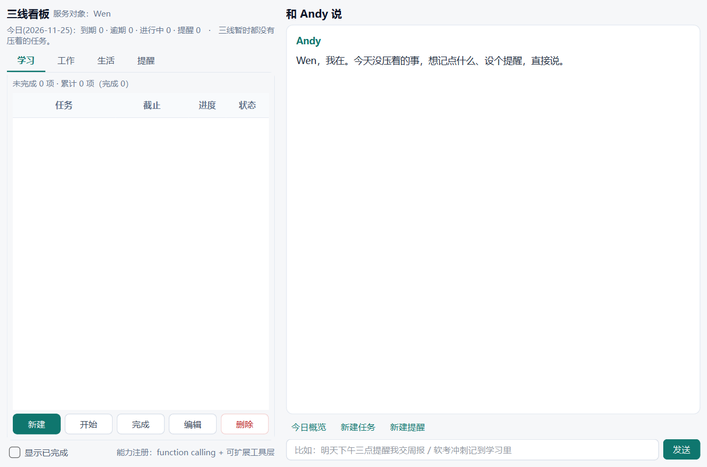
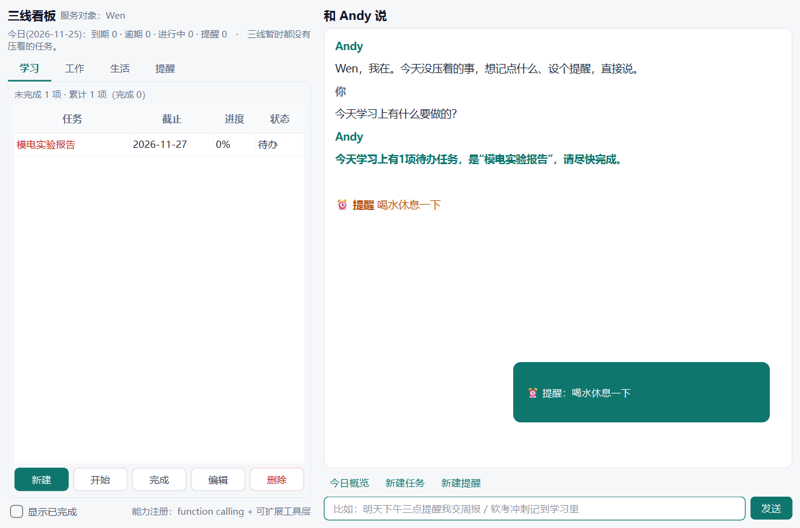

# Andy Desk

> 桌面端 AI 学习 / 工作 / 生活三线管理助手

Andy Desk 是一个运行在 Windows 桌面的个人事务管理助手：左边是三线看板，右边是流式对话。用户用自然语言说“把软考冲刺记到学习里，12 月 5 号截止”“每天 19:30 提醒我复盘”，后台大模型会自主判断该调用哪个工具、传什么参数，再把结果回填成回复。

它不靠“聊完就忘”的通用对话，而是把任务、提醒、长期事实都落到本地 SQLite；下一次对话还能通过 embedding 语义检索找回相关内容。数据留在本机，单用户运行，不需要服务器。





---

## 功能

| 能力 | 示例说法 | 实现 |
|---|---|---|
| 记任务 | “把软考冲刺记到学习里，12 月 5 号截止” | `task_create` → `tasks` 表 |
| 拆任务 | “帮我拆一下挑战杯答辩准备” | `task_breakdown` → 子任务 |
| 改进度 | “算法题那项做到一半了” | `task_list` 找 id → `task_update` |
| 定时提醒 | “每天 19:30 提醒弟弟写作业” | `reminder_create` → 30 秒心跳调度 |
| 问今天 | “今天还有什么要紧的” | `overview_today` + 三线看板 |
| 记长期事实 | “以后十点后别提醒我学习” | `memory_save` → `semantic_facts` |
| 换说法找往事 | “我那个证的事怎么样了” | embedding-3 语义检索 + 关键词 RRF |
| 手动管理 | 左侧看板新建 / 开始 / 完成 / 编辑 / 删除 | PyQt6 |

时间规则：说“提醒”但没给钟点时，Andy 会先反问，不会瞎猜一个时间。

---

## 技术栈

- Python 3.10、PyQt6
- 智谱 GLM-4-flash，经 OpenAI SDK 调用（`function calling` + 流式输出）
- SQLite：任务、提醒、对话事件、语义事实、向量索引
- Embedding-3（2048 维）：语义检索与向量编解码
- numpy、python-dotenv、pytest

---

## 快速开始

### 1. 环境要求

- Windows 10 / 11（主力支持；Linux / macOS 可跑 CLI，但 PyQt6 需要额外图形库）
- Python 3.10
- 一个智谱开放平台的 API Key

### 2. 克隆与安装

```powershell
git clone https://github.com/SWI423/Andy-Desk.git
cd Andy-Desk

python -m venv .venv
.\.venv\Scripts\Activate.ps1

pip install -r requirements.txt
```

Linux / macOS：

```bash
git clone https://github.com/SWI423/Andy-Desk.git
cd Andy-Desk
python3 -m venv .venv
source .venv/bin/activate
pip install -r requirements.txt
```

### 3. 配置密钥

```powershell
Copy-Item .env.example .env
notepad .env
```

把 `ZHIPU_API_KEY` 换成自己的 Key。`ZHIPU_BASE_URL`、`ZHIPU_CHAT_MODEL`、`ZHIPU_EMBED_MODEL` 已有默认值，一般不用改。`.env` 已被 `.gitignore` 排除，不会进仓库。

### 4. 启动

```powershell
python main.py
```

首次启动会自动在 `data/` 下建库，并在 `logs/` 写日志。

---

## 其他入口

```powershell
python main.py --cli        # 终端对话，不打开窗口
python main.py --selftest   # 窗口自检，3.5 秒后自动退出，截图存 logs/

python scripts/smoke_core.py            # 核心链路（独立库 data/smoke_<时间>）
python scripts/smoke_core.py --no-llm   # 只测本地逻辑，不调模型、不联网
python scripts/smoke_gui.py             # GUI 全流程 + 截图（独立库）
python scripts/check_retrieval.py       # 关键词 / 向量 / 混合检索对照
python scripts/functional_audit.py      # 50 项离线功能审计（不调模型）
python scripts/memory_eval.py           # 记忆检索 R@1 / R@3 / MRR / 噪声
python scripts/eval_memory.py --variant hybrid   # 扩展复核（39 条语料 / 15 问句）
python scripts/task_eval.py             # 18 个任务场景评测（真调模型）
python scripts/chat_flow.py             # 11 轮连续对话流程（真调模型）
python scripts/backfill_embeddings.py --status   # 查看向量索引状态

python -m pytest tests -q               # 46 项单测
```

测试脚本默认使用独立数据库（`data/audit_*`、`data/memeval_*` 等），不会污染正式库 `data/baymax.db`。

---

## 界面

- **左侧三线看板**：学习 / 工作 / 生活 / 提醒 四个页签；列为任务、截止、进度、状态。双击行可编辑；高优先级红色，逾期橙色。
- **右侧对话**：流式输出；快捷按钮为今日概览 / 新建任务 / 新建提醒。
- **顶部状态条**：今日到期、逾期、进行中、提醒数。
- **提醒浮层**：到点在右下角弹出，同时写入对话流。

---

## 目录

```text
Andy-Desk/
├─ main.py              入口（GUI / CLI / 自检）
├─ config.py            配置与路径（全部基于 BASE_DIR）
├─ console.py           日志双写（终端 + logs/）
├─ prompts.py           人设 + 处理范式
├─ core/
│  ├─ db.py             连接 / 建表 / 通用查询（含 event_vectors）
│  ├─ embedding.py      embedding-3 调用、余弦、向量编解码、查询缓存
│  ├─ memory.py         事件流水、事实蒸馏、上下文组装、混合检索、补索引
│  ├─ tasks.py          三线任务 CRUD、子任务、今日概览
│  ├─ scheduler.py      提醒规则、心跳调度、启动补发
│  ├─ tools.py          8 个工具的 schema + 注册表
│  ├─ brain.py          流式对话 + 工具循环 + 时间硬拦截
│  └─ rag.py            （预留）
├─ desktop/
│  ├─ main_window.py    三线看板 + 对话 + 提醒
│  └─ theme.py          浅色主题
├─ docs/                PRD / WBS / MEMORY_DESIGN / DECISIONS / PROGRESS / TEST_REPORT
│  └─ images/           README 截图
├─ scripts/             冒烟、评测、审计、补索引脚本
├─ tests/               pytest
├─ data/                SQLite（不入库）
└─ logs/                运行日志与截图（不入库）
```

---

## 架构

```text
PyQt6 窗口
   ↓ 用户输入
brain：时间拦截 → 上下文组装 → 模型（流式）→ 工具循环
   ↓                              ↓
memory（事件 / 事实 / 向量检索）   tools 注册表
   ↓                              ↓
SQLite（tasks / reminders / chat_events / semantic_facts / event_vectors）
   ↑
scheduler（30s 心跳 → 到点回调 → 窗口浮层）
```

记忆设计见 `docs/MEMORY_DESIGN.md`；关键取舍与升级条件见 `docs/DECISIONS.md`。

---

## 扩展一个新能力

以“查天气”为例，只改 `core/tools.py`：

1. 在 `TOOLS` 里加 schema：

```python
{"type": "function", "function": {
    "name": "weather_query", "description": "查某地天气",
    "parameters": {"type": "object",
                   "properties": {"city": {"type": "string"}},
                   "required": ["city"]}}}
```

2. 写实现函数 `_tool_weather_query(city)`，返回 `dict`。
3. 在 `TOOL_REGISTRY` 登记 `"weather_query": _tool_weather_query`。

对话层和窗口层不用动。要接外部 HTTP 服务，把实现函数换成对应的请求即可。

---

## 部署说明

这是桌面应用，**不需要服务端部署**。源码跑起来就是完整形态：

- 依赖、密钥、启动三步见“快速开始”。
- 数据库、日志都在本机 `data/`、`logs/`，首次运行自动创建。
- 不要把 `.env`、`data/`、`logs/` 提交到仓库；`.gitignore` 已处理。
- 当前未提供正式安装包。若要分发给没有 Python 的电脑，可自行用 PyInstaller 打包；打包参数需要按本机环境调整，不属于本仓库已验证范围。

---

## 已知限制

- **程序关着不会提醒**：提醒依赖进程内 30 秒心跳；关机提醒需要系统计划任务或常驻服务。
- **触发精度 30 秒**；启动时只补发一次汇总，不逐条补。
- **检索依赖 embedding 接口**：接口不可用时自动退回关键词，换说法可能漏召回。阈值 0.10 是当前小语料标定值，语料变大需复核。
- **检索不做时间衰减 / rerank**：三个月前和昨天的权重一样，前 3 条可能同题挤占。
- **不做医疗诊断**；身体不适只给常识建议。
- **不自动发微信 / 邮件**：只生成内容，发送由用户确认。
- **单用户、无登录**；数据在本地 `data/baymax.db`。
- 对话依赖网络与智谱 API；断网时看板和提醒仍可用，对话会提示失败原因。

---

## 验证记录（2026-11-25 ~ 2026-11-26）

| 检查 | 方式 | 结果 |
|---|---|---|
| 克隆复跑 | 从 GitHub 重新 clone 后 `pytest tests -q` | **46/46 PASS**（2026-11-26） |
| 单测 46 项 | `pytest tests -q` | 全部通过（含 23 项回归） |
| 离线功能审计 | `scripts/functional_audit.py` | **50/50 PASS** |
| 记忆检索评测 | `scripts/memory_eval.py` | 混合 **R@1 100% / R@3 100% / MRR 1.00 / 噪声 0.10** |
| 记忆扩展复核 | `scripts/eval_memory.py --variant hybrid` | 39 条语料 / 15 问句 **hit@1 100%、MRR 1.00** |
| 任务场景评测 | `scripts/task_eval.py` | 18 场景 **19/19 PASS** |
| 多轮连续对话 | `scripts/chat_flow.py` | 11 轮 **4/4 PASS** |
| 检索降级 | 单测 `test_fallback_when_embedding_down` | 向量不可用时仍按关键词召回 |
| GUI 全流程 | `scripts/smoke_gui.py` | 建任务 → 对话 → 工具结果 → 提醒浮层 → 截图 |
| 窗口自检 | `python main.py --selftest` | 7 模块健康检查 OK |
| 并发写 | 8 线程建任务 | 0 错误、8 条全在、无重复 |

未覆盖：长时间挂机跨天、真实到点触发、100 次混合读写压测、多用户 / 多设备。缺陷与修法见 `docs/TEST_REPORT.md`。

---

## 路线图

- [x] 三线任务看板与流式对话
- [x] 8 个内置工具与 function calling 循环
- [x] 三层记忆与 embedding-3 语义检索
- [x] 提醒心跳、启动补发与错过计数
- [x] 回归测试、记忆评测、任务评测
- [ ] MCP 客户端框架（配置化接入外部工具）
- [ ] 语音播报（TTS）与语音输入（ASR）
- [ ] Windows 安装包

---

## 安全与隐私

- API Key 只放在本地 `.env`，仓库只保留 `.env.example` 占位符。
- 任务、提醒、对话记录、向量索引全部存在本地 SQLite。
- 对话内容会发送给智谱 API 用于生成回复和 embedding；除此之外没有额外上报。
- 本项目为个人学习与自用项目，暂未指定开源许可证。
